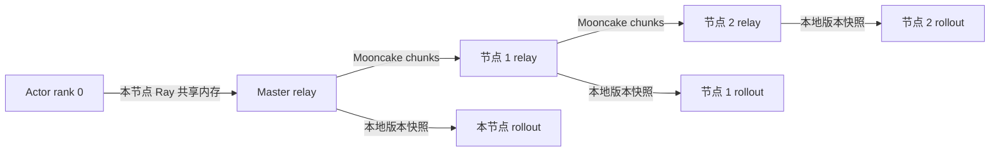

# Mooncake 分层 CPU Relay

`mooncake_relay` 是真实 Laminar 训练路径的多节点后端；原有 `cpu_relay` 保留。
实现位于 [mooncake_relay.py](mooncake_relay.py)，使用
[Mooncake TransferEngine Python API](https://github.com/kvcache-ai/Mooncake/blob/main/docs/source/api-reference/python/transfer-engine.md)
进行内存注册和同步写入，并在异步任务中构成跨 hop 的分块流水。
它不复用原 `mooncake` checkpoint 后端的全局通信组或同步广播。

## 数据路径



- trainer rank 0 所在节点成为 master 节点；所有 actor rank 仍参与 FSDP 参数收集。
- 根据实际 rollout worker 的 Ray node ID 去重，每个节点创建一个 CPU relay，
  并用硬节点亲和性放置；同节点的多个副本共享一个 relay。
- actor 到 master 的快照在同节点 Ray object store 中传递。跨节点 RPC 只传
  元数据、地址、摘要和完成通知，权重数据由 Mooncake 传输。
- 默认每批最多 64 MiB、64 个块。小张量共用一次原生 batch write 和一次
  接收确认；每块仍独立校验，整批校验通过后才确认接收进度。中间 relay 可转发
  已校验的批次，无须等完整版本
  收齐；不同版本按顺序传播。默认至多两个待传播版本，超出后出版端施加背压。
- master 本地版本提交后，actor 可以继续训练，不等待广播完成或所有 rollout 拉取。
  该承诺不消除 master 本地 staging 的耗时，也不取消传播积压时的背压。
- 每个节点只有在完整版本收齐、所有块校验通过后，才将其原子发布给本地消费者。
  消费者的不可变 Ray 快照与临时原生传输缓冲区各自拥有生命周期。
- rollout 在自身 drain 边界向本节点 relay 请求控制器指定的精确版本；版本未到达
  时等待，禁止退回读取远端 master 的 Ray 数据。worker 再次校验 manifest node ID。
- 读租约保持到该副本所有 TP worker 完成加载和 finalize；旧版本按保留策略回收。
  原生注册缓冲区在下游确认后注销；取消必须先等待阻塞 native 调用结束。
- 每条生成轨迹继续固定 policy version，old_log_probs 继续沿用实际 vLLM behavior
  logprob；轨迹迁移机制仍然是同版本 abort + prefix re-prefill。

内存注册由 Mooncake 负责；Ascend 模式使用 Torch pinned-memory 分配，
没有独立 slab 分配器或 relay 侧 TP 预重分片。下游 vLLM 仍按原接口加载完整命名张量。

## 权重导出

发布端先在源设备把浮点参数转换为 BF16，再异步复制到 CPU 锁页内存。
避免将精度转换与设备迁移合并在一次 `.to(cpu, dtype=bf16)` 调用中；
部分 Ascend/PyTorch 组合会因此在主机端执行转换，显著增加导出耗时。
临时快照按 `update_weights_bucket_megabytes` 分批，每批复制完成后才交给
Ray，源张量和锁页缓冲区在同步完成前保持存活；失败时也先等待复制结束。
单张量超过 bucket 会在导出时直接报错。
relay 侧锁页缓冲区的分配和复制在后台线程完成，提前计入容量预算；
准备新版本时，事件循环仍可处理旧版本请求和心跳，取消时等待后台操作结束。

数据仍经过 CPU 版本快照；这项优化不把分层 CPU relay 改成 NPU 到 NPU 直传。
版本、读租约、原子发布和 SHA256 校验保持相同语义。
`publish_cpu_copy_seconds` 包括源设备转换、主机分配、入队和等待复制；
`publish_device_cast_seconds` 记录转换入队时间，`publish_copy_wait_seconds`
记录批次等待时间，二者不代表独立的设备执行耗时。另有
`publish_staging_peak_bytes` 和 `publish_staging_flushes` 记录临时快照峰值与批次数。

## 依赖与配置

所有 relay 节点需要可用于 **CPU host-memory** 传输的 Mooncake。协议明确配置为
`rdma`、`tcp` 或 `ascend`；默认 `rdma`，失败时不会静默切换成 TCP。
RDMA 模式要求节点具备可用设备及匹配的网络配置。TCP 可用于数据路径正确性测试。

部分 Ascend 版 Mooncake 即使选择 TCP，也会在初始化时自动建立设备 transport，
而普通上游 CUDA wheel 在纯 Ascend 环境可能因缺少 libcuda/libcudart 无法导入。
可以通过 `trainer.v1.laminar.mooncake.runtime_env.env_vars` 仅为 relay actor 提供
隔离的 CPU 版本，保留训练/vLLM 的 Ascend 环境。

Ascend ADXL 模式设置 `trainer.v1.laminar.mooncake.protocol=ascend`。
该模式在每个执行原生调用的线程绑定 NPU 上下文，使用锁页 host-memory
收发缓冲区；普通 NumPy 内存可能注册成功、却在跨节点建链时失败。
`device_name` 在此模式下为本进程可见的 NPU 索引，空字符串使用 `0`。
relay 虽然保存 CPU 权重，仍需要对应 NPU 的访问权限和上下文内存。
上游 Ray 快照会复制到锁页内存，接收端也会复制回 Ray 快照。

当前配置：

```yaml
trainer:
  v1:
    laminar:
      keep_last_versions: 2
      mooncake:
        chunk_bytes: 67108864
        protocol: rdma
        device_name: ""
        verify_checksums: true
        acquire_timeout_s: 900
        max_pending_versions: 2
        runtime_env: {}
```

块摘要默认开启；数据损坏、传输失败或等待超时会报错，尚无自动链路修复。
本地接收快照仍经过 object-store 拷贝，不能宣称全路径零拷贝。消费者的
`update_weights_bucket_megabytes` 还须容纳最大的单个张量；网络分块解决的是跨节点
传输粒度，不代表已改变 vLLM 命名张量加载的 bucket 限制。

## 启动

```bash
bash examples/trajectory_async/run_qwen35_9b_laminar_mooncake.sh --check-config

# 两个节点、每节点 16 NPU：每节点 8 trainer + 8 rollout，总计 32 NPU。
# 两节点须已加入同一个 Ray 集群，模型/数据/仓库路径可访问。
TRAINER_NNODES=2 ROLLOUT_NNODES=2 \
  MOONCAKE_RELAY_PROTOCOL=rdma \
  python3 submit_qwen35_laminar.py --relay-backend mooncake

# 四节点相同布局，总计 64 NPU：
TRAINER_NNODES=4 ROLLOUT_NNODES=4 \
  MOONCAKE_RELAY_PROTOCOL=rdma \
  python3 submit_qwen35_laminar.py --relay-backend mooncake
```

`TRAINER_NPUS_PER_NODE` 和 `ROLLOUT_NPUS_PER_NODE` 分别控制两类资源的每节点数量，
默认均为 8。`MOONCAKE_RELAY_DEVICE_NAME` 可以指定同名 HCA 过滤器，包括逗号分隔值。
实际 placement 由 Ray 资源池创建；relay 跟随真实 worker 节点，而不是假定节点编号。
每个 TP replica 必须完整落在一个节点；跨节点 TP、PP>1、engine DP>1 和 PD 尚不支持。

多节点运行默认将结果写到仓库 `outputs`。应保证输出、数据和 checkpoint 路径在
相关节点可访问；`/tmp` 输出只适合当前单节点测试，不能假设各机器共享本地磁盘。
依赖可通过如下 Hydra 项传给 relay；这些路径须在每个 relay 节点实际存在：

```text
+trainer.v1.laminar.mooncake.runtime_env.env_vars.PYTHONPATH=/your/cpu-mooncake:/your/verl
+trainer.v1.laminar.mooncake.runtime_env.env_vars.LD_LIBRARY_PATH=/your/cpu-mooncake/mooncake
```

也可用环境变量配置相同隔离路径；启动器会追加已有 Python/库目录：

```bash
export MOONCAKE_RELAY_PYTHON_PATH=/your/cpu-mooncake
export MOONCAKE_RELAY_LIBRARY_PATH=/your/cpu-mooncake/mooncake
```

设置库路径时按需要追加本机其他运行库目录，避免覆盖它们。

## 原生传输探针

探针连接已有 Ray 集群，只创建自己拥有的 CPU actor；不进入 TQ init/close，
不重启 Ray、不接触其他训练任务。

```bash
# 真正的三节点验证：默认要求三个不同的存活节点。
python3 -u probe_mooncake_relay.py --protocol rdma --relays 3

# 当前只有一个物理节点时，显式选择同机三进程 TCP 验证。
python3 -u probe_mooncake_relay.py --protocol tcp --relays 3 --allow-colocated \
  --mooncake-python-path /tmp/verl-mooncake-cpu-python \
  --library-path /tmp/verl-mooncake-cpu-python/mooncake
```

原生探针验证 BF16、整型标量、空张量、两版本字节哈希一致性、本地加载、读租约
保留与回收、链各 hop 的实际收发字节和最终无 pending transfer。输出明确记录
`physical_nodes`、`logical_relays` 和 `protocol`，避免混淆同机进程与多节点实验。

## 当前验证记录与边界

2026-10-19 当前 Ray 集群仅有一个存活节点，未见 InfiniBand 设备：

- 最终完整 V1 + Qwen3.5 decoder CPU 套件通过 **233 项，跳过 2 项**；
  相关 relay/Laminar 套件通过 36 项，包含 native 注册/写入取消和 Hydra runtime_env 深转换用例。
- 使用官方 Mooncake v0.3.13 源码 commit
  `e5598b0992cc258b06d22f24d875480e8931a28e` 在 `/tmp` 构建 CPU 组件，
  关闭 CUDA、Ascend、Store，未修改系统 Python/CANN 包。
- 真实 Mooncake TCP 的三进程两 hop 探针已通过：两个版本各 65544 字节，
  两个发送 hop 各传输 131088 字节、18 块；各节点最终无 lease、pending 或 failure。
- 当前 `/tmp/verl-mooncake-cpu-python` 是本节点实验依赖，并非已部署的多节点包。
- 最初 smoke 在 relay 创建时因嵌套 Hydra DictConfig 不被 Ray runtime_env 接受而失败，
  未开始训练。已修复深转换并加入回归测试。
- 修复后任务 `qwen35_9b_mooncake_relay_smoke_20261019_v2` **SUCCEEDED，exit 0**：
  两次 actor 更新、64 条训练样本和 4 条验证，版本 0/1/2；最终事件审计通过，
  6 次正式迁移和 6 次其他请求仍活动时的独立拉权重。总计约 8.76 分钟，含初始化。
  该任务的思考响应上限为 256 token，训练奖励/梯度均为零，验证正确率为零；
  它验证整模型执行、版本和加载路径，不构成学习效果或新后端 24K 性能证据。
- 在当前无 RNIC 的环境中，显式 RDMA 初始化已验证会报错，未退回 TCP。
  经典后端的协议选择还通过 MC_FORCE_TCP/MC_FORCE_HCA 显式约束。

尚未验证：跨物理节点传输、RDMA 带宽、32/64 NPU scaling。尚未实现：机器失联后的自动节点故障
接管、跨机器广播链重配置/coordinator 选主、历史版本灾后恢复和 TP 预重分片。这些能力不能由
当前 fail-closed 行为或同机 TCP 探针推断。


进行中轨迹接管和权重保留现已接入；每个 relay 的版本/字节预算包括 native receive
和本地 Ray snapshot staging，容量不足时背压发布。权重清理条件及 vLLM 驻留版本
备份的设计记录见 [PARTIAL_RECOVERY.md](PARTIAL_RECOVERY.md)。


## Relay 进程容错更新

默认已接入稳定 endpoint、内存 catalog、native master 主备和进程级广播链重建；底层
core 的 fail-closed 错误由恢复层处理。协议、epoch 隔离、对象 owner、磁盘成本和
节点故障边界见 [RELAY_RECOVERY.md](RELAY_RECOVERY.md)。设置
`trainer.v1.laminar.mooncake.recovery.enabled=False` 可显式使用原无恢复的底层路径。


2026-10-20：recovery.persist_to_disk 默认 false，不为每次发布写整模型备份或 catalog。
partial_store.persist_to_disk 也默认 false。内存 catalog/partial-store 丢失后明确失败，
持久化/异步备份作为遗留事项；不要沿用旧磁盘任务的恢复保证或发布时间。
在线 Roofline 见 [ONLINE_ROOFLINE.md](ONLINE_ROOFLINE.md)。


2026-10-20 权重发布优化：默认使用 4 线程 SHA256，并对 catalog 已校验的同版本、
同 schema、同一组不可变 Ray ObjectRef 复用本地验证结果，避免重复扫描全模型。
新增导出、CPU 拷贝、Ray put、catalog/native/endpoint 分阶段计时。配置、验证边界和
实测结果见 [WEIGHT_PUBLICATION.md](WEIGHT_PUBLICATION.md)。

## 周期与最终评测

独立评测使用 `data.val_files` 作为常规数据集；
`trainer.v1.laminar.evaluation.final_val_files` 可配置最终版本的数据集。
最终版本在私有评测视图中加载该数据集，保留常规训练视图和其他评测任务的数据集。
设为 null 时，最终评测继续使用 `data.val_files`。

例如常规只评测 MATH-500，训练结束评测 MATH-lighteval：

```text
data.val_files=['/datasets/math500_test.parquet']
trainer.test_freq=10
trainer.v1.laminar.evaluation.final_val_files=['/datasets/math_lighteval_test.parquet']
trainer.v1.laminar.evaluation.max_concurrent_versions=3
trainer.v1.laminar.evaluation.overflow_policy=block
```

`block` 在三个评测任务满载时等待任意一个任务完成，再提交当前触发版本；
其余任务继续运行，不合并或丢弃待评版本。训练会在评测触发点承受背压。
默认 `latest` 仍保留最多一个最新待评版本，`skip` 则跳过满载时的触发版本。
`trainer.test_freq=-1` 会同时跳过周期和最终评测，适用于只验证训练链路的短跑。
