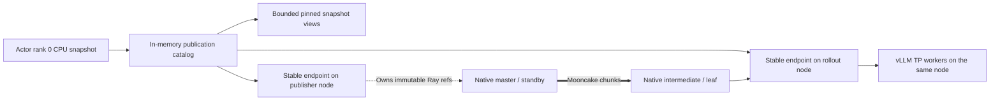

# Mooncake relay 进程容错与恢复

适用 `trainer_mode=laminar`、`checkpoint_engine.backend=mooncake_relay`。
恢复层默认启用，保留原来的节点内加载和跨节点 Mooncake 数据通道。

**2026-10-20 默认变更：可靠性数据先保存在内存，不落盘。**权重快照、catalog、
owner/lease 不写恢复文件；下述磁盘方案仅是显式开启 persist_to_disk 后的可选路径。
分析用 relay_events.jsonl 仍保留。避免每版约 18.8 GB、实测约 55 秒的同步备份
进入发布关键路径；这不代表完整权重导出、摘要校验和加载已经零开销。
本页区分 relay 进程故障与机器/Ray 集群故障，不等同于完整 trainer checkpoint。

## 结构与权重来源



- **Stable endpoint**：每个节点一个 CPU actor，保管不可变模型快照，独立于
  TransferEngine 进程。接收端用 `ray.put(..., _owner=endpoint)` 明确转移对象所有权，
  并在确认前将引用交给 endpoint。不能仅将 core 创建的 ObjectRef 存到另一个 actor：
  ObjectRef 的原 owner 死亡后，引用仍可能失效。
- **Native core**：只处理 CPU 内存注册、原生 TCP/RDMA 写入和分块流水线。
  发布节点有一个冷 standby；故障恢复时可切换 native master。
- **Coordinator/catalog**：默认在独立 CPU actor 内存保存版本、引用 owner、读取 lease、
  retention revision 和 topology epoch，同时 pin 不可变 Ray snapshot 的 numpy view；
  不为每条轨迹复制模型，不再写 catalog/fsync。内存 coordinator 禁止自动重启与任务重试，
  丢失时明确失败，不能从空版本历史继续。显式开启磁盘模式后才支持持久化 catalog 重建。
- **可选 Disk snapshot（默认关闭）**：每个权重版本在发布节点写一次完整 CPU 备份，不在每条轨迹上
  复制模型。逐张量保存原始字节及 SHA256；全部文件 fsync 后原子提交版本目录，
  再原子更新 catalog，最后才能确认发布。磁盘损坏/空间不足时明确失败。
- Ray 传递控制、对象引用和节点内数据；跨节点 relay 模型传播仍走 Mooncake。
  如果备份目录位于共享 NFS，写备份本身也有文件系统网络 I/O，不能算作零网络开销。

权重引用的 owner 与原生传输进程分离，因此 core 退出不会使健康 endpoint 的
已有快照失效。endpoint 自己重启时，缺失的精确版本由存活 catalog pin 的内存快照及 Mooncake 补齐；
显式磁盘模式才从磁盘恢复。
消费者持有旧 endpoint incarnation 的 ObjectRef 时，checkpoint engine 可以用原
lease 重新取得同版本 manifest；逐项检查名称、形状、dtype 和内容摘要，不换策略版本。

## 恢复协议

1. 心跳检测 native core 失效、内部传输失败、incarnation/epoch 变化或 endpoint 重建。
2. 协调器递增 topology epoch（默认内存保存），先拒绝旧 epoch 的快照安装。
3. 重启本层管理的全部 native cores，等待它们都报告新的 incarnation。
   **所有旧写入进程消失之前，不给新引擎分配接收缓冲区。**不能在旧 RDMA 写入仍
   运行时，单纯替换目标地址后立即复用内存。
4. 在发布节点切换主备 native master，重新配置广播链和节点本地对象 owner。
   这是同一发布节点上的进程主备，不是跨机器分布式共识选主。
5. 保留完整的节点缓存。只有缺失版本的节点需要接收模型字节；已完整缓存该版本的
   中继用自身快照向下游转发，避免为健康缓存重复创建模型副本。
6. 按版本顺序恢复 catalog 中仍被保留的快照，校验 checksum，再开放新权重发布。
   已确认发布但最后一次 RPC 回复丢失时，按版本和内容摘要幂等重试。

恢复过程暂停权重发布/缺失快照的获取；**不调用 vLLM pause，不停止健康实例的
已有轨迹**。已缓存版本仍可获取。读取 lease 和保留 owner 在 native/endpoint 重建后继续有效；
只有显式磁盘模式支持协调器重启后恢复这些元数据。
新 epoch 和单调递增的 retention revision 防止延迟控制消息回滚保留集合。

## 配置与容量

```yaml
trainer:
  v1:
    laminar:
      keep_last_versions: 2
      weight_budget:
        max_versions: 4
        max_bytes: 103079215104 # 每个 relay 96 GiB 权重 payload 预算
        capacity_timeout_s: 600.0
      mooncake:
        acquire_timeout_s: 900
        recovery:
          enabled: true
          persist_to_disk: false
          hash_workers: 4
          reuse_verified_source: true
          directory: null
          heartbeat_interval_s: 5.0
          rpc_timeout_s: 10.0
          recovery_timeout_s: 900.0
          max_retries: 3
          retry_interval_s: 0.5
```

默认事件目录为 `event_dir/relay_recovery`，内存模式仅写分析日志。可选磁盘模式下，
目录、输出位置和每个 relay 的 CPU-compatible
Mooncake 依赖须实际可访问。`/tmp` 仅适合当前单节点进程故障测试；生产任务按恢复
需求使用持久盘。目录仅用于同一模型、同一次训练运行，不可随意给新训练复用。

保留集合包括最近版本、未完成轨迹引用、消费者读取 lease，以及未完成的广播。
只有最后一个引用和原生广播都释放后，才回收 catalog、节点缓存与 pin 的内存 view；
显式磁盘模式也回收对应版本目录。
未确认的 staging 文件和孤立版本目录在协调器重启时清理。

版本数和字节上限同时约束 CPU 备份保留与发布 staging，接收端预留 native buffer
和本地 Ray copy。容量不足时背压发布，不能删掉活跃旧版本来满足预算。
磁盘上限按保存的 payload 核算，临时提交还需一份模型空间；文件系统的元数据、
page cache、Ray 元数据、消费端转换和设备内存仍需额外余量。进程总 RSS 不由该预算硬限制。

**仅显式 persist_to_disk=True 时，每次发布增加完整模型的磁盘写入、校验和 fsync 成本。**这换取了不依赖 native core
或 endpoint 存活的恢复源；不能继续将早期无磁盘备份任务的发布时间当成本实现性能。
持久化/异步备份作为遗留事项暂不启用；若重启开发，必须先定义确认语义、队列预算和独立故障域的保底副本。

`await relay.recovery_status.remote()` 可查看 epoch、native master 槽位、保留版本、
lease/owner 数、磁盘 payload 字节、等待发布数和恢复状态。
完整事件保存在 `relay_recovery/relay_events.jsonl`，包括 backup_begin/committed、
recovery_begin/retry/complete/failed 和 published。

## 验证

```bash
python3 -m pytest -q -o cache_dir=/tmp/verl-relay-tests \
  tests/trainer/ppo/v1 tests/models/test_qwen35_decoder_compat_on_cpu.py

# 只有显式允许时，使用同一物理节点的三个逻辑 relay。
python3 -u probe_relay_recovery.py --allow-colocated --protocol tcp \
  --mooncake-python-path /tmp/verl-mooncake-cpu-python \
  --library-path /tmp/verl-mooncake-cpu-python/mooncake
```

探针只管理自己创建的 actor，不重启 Ray，不影响其他训练任务。覆盖 native
intermediate/master、endpoint、coordinator 和 root endpoint 进程终止，校验两个
精确版本的内容、消费者已持有 manifest 时的对象恢复、主备切换与旧版本回收。
真实执行结果会明确报告 physical_nodes，不能把同机多进程当作多节点 RDMA 验收。
最终验收记录见 README。

## 边界

- 默认内存模式已实现 native master、relay core、缓存 endpoint 的进程恢复，
  **catalog、训练 actor 和当前 Ray/object store 必须存活**。catalog 故障明确停止，不能自动重建空状态。
- 可选磁盘模式曾验证 catalog 进程重建；它不是当前默认性能路径。
- 当前链重建会重启本链所有 native cores，以保证旧写入已停止；不是逐 hop 无扰动修复。
- 尚未实现机器失联后的节点驱逐和跨机器 coordinator 选主、整个 Ray/object store
  故障恢复、存储设备丢失后的异地副本恢复。这些需要新的资源和持久化协议。
- vLLM 驻留权重直接导出、完整 actor/optimizer/TQ/inflight 一致 checkpoint 仍未实现。
- 跨物理节点/RDMA、32/64 卡 scaling 和 24K 长轨迹下的长期容错性能仍需验收。


## 已登记遗留事项：持久化可靠性

按用户要求暂缓恢复数据落盘，包括整模型备份、catalog journal 和轨迹 SQLite。
后续再实现不阻塞发布的异步备份、受限待备份队列、未完成备份的内存保底、
跨机器故障域及完整 checkpoint 一致恢复，并测量对吞吐的净影响。
保留可选磁盘代码与测试不等于已实现上述异步/灾后恢复。

2026-10-19 的磁盘版本 16 NPU 故障任务完成 2 次更新及 4 条验证；native master
重建实测约 30.6 秒，期间健康 rollout 完成 56 条轨迹。每版同步备份约 55 秒是
旧路径记录，不能作为当前内存模式的发布时间或吞吐指标。
在线容量标定见 [ONLINE_ROOFLINE.md](ONLINE_ROOFLINE.md)。

内存 catalog 同时 pin 原始 Ray ObjectRef 和只读 numpy view；root endpoint 重建时
重新挂接同一组源引用，避免为所有保留版本额外复制一整份模型并突破内存预算。


## 2026-10-20 验收记录

- 最终 V1 + Qwen3.5 decoder CPU 回归：**315 passed，2 skipped**。覆盖明确膝点、
  无膝点、上下文干扰、P95 毛刺、分块置信度、TP 慢 rank、后台关闭时只标定、
  显式重调度兼容性、内存精确版本恢复与根端点原引用复用。
- 16 NPU 任务 `qwen35_9b_memory_roofline_20261020_v2` **SUCCEEDED**：2 次更新、
  64 条训练样本及 4 条验证，版本 0/1/2，事件审计一致。四个 TP2 replica 共收到
  **562 条**对齐后的纯 decode 样本，与两 rank 的 sampled 数逐实例一致，零探针错误。
- 有足够样本的 batch 档位主要为 8，另一个实例覆盖 2；所有 profile 正确返回
  `insufficient_coverage`，保留上限 8，**没有声称已找到真实硬件膝点**。
  不同 batch/context 全覆盖及 24K 标定仍需后续工作负载验证。
- 未创建模型 tensor 备份、catalog.json 或 partial_trajectories.sqlite。
  无数据库意味着这次只能做事件谱系审计，不能声称做过离线持久化 token/chunk 审计。
- 默认内存模式真实 Mooncake TCP 故障探针覆盖 intermediate/master/endpoint/root endpoint，
  两个精确版本和旧版本 GC 均通过；1 个物理节点、3 个逻辑 relay。catalog 不作自动重启。
- 256-token 任务验证系统执行和采集接口；不证明 24K 学习效果、RDMA/multi-node scaling
  或正式性能收益。该基线任务的发布总耗时约 30–33 秒，包含权重导出、摘要和本地提交；
  后续优化与分阶段计时见 [WEIGHT_PUBLICATION.md](WEIGHT_PUBLICATION.md)，消费者设备加载另行计时。

结果报告：`/tmp/verl-laminar-runs/qwen35_9b_memory_roofline_20261020_v2/final_memory_roofline_report.json`。
